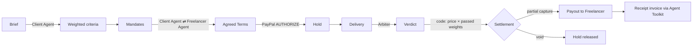

# Handshake

**Two AI agents negotiate a freelance deal. PayPal holds the money. A neutral AI judges the work. Code, never a model, settles it.**

Built during the [PayPal AI Hackathon](https://paypalaihackathon.devpost.com/) (Oct–Nov 2026).

**Live demo:** https://handshake-woad-xi.vercel.app (PayPal sandbox, test money only)

## The problem

Paying a freelancer you've never met means one side takes the risk: pay up front and hope, or deliver first and hope. Escrow fixes the trust problem but adds paperwork, and "was the work good enough?" still ends in an argument.

Handshake turns a deal into something checkable. The Client's Agent writes the acceptance criteria, both sides' Agents negotiate the price and how much each criterion is worth, PayPal holds the money, and a neutral Arbiter checks the Delivery against each criterion. The Freelancer is paid for exactly the criteria they met.

## Try it in two minutes

The demo has no accounts. Switch between **Maya** (the Client) and **Dev** (the Freelancer) at the top left.

1. As Maya, write a Brief (or keep the sample) and let her Agent draft the criteria. Approve them.
2. Set both Mandates (Maya's budget, Dev's minimum price) and start the negotiation. Watch the two Agents' Offers converge.
3. As Maya, **Hold** the agreed price with PayPal. Use a PayPal sandbox *personal* account:
   - Email: `<sandbox buyer email>` <!-- TODO before submitting: fill in, or point judges to Devpost testing notes -->
   - Password: `<sandbox buyer password>`
4. As Dev, load a sample Delivery (*Strong*, *Partial*, *Weak* or *Prompt injection*) and submit it. The Arbiter judges it.
5. A 30-second Contest Window opens. Click **Settle now** as both people, or contest. Then watch PayPal capture, release, pay out and issue a receipt.
6. Open the **Ledger** to see every PayPal call with PayPal's own reference.

## How it works



1. **Brief → criteria.** The Client's Agent turns a plain-English Brief into 3–6 checkable criteria with suggested weights. It is told never to write criteria an empty or off-topic Delivery could pass.
2. **Mandates.** Each person sets their Agent's limits: the Client's budget and deadline, the Freelancer's minimum price, and floors or caps on criterion weights. Each Agent sees only its own Mandate.
3. **Negotiation.** The Agents trade Offers (price, deadline, weights) for up to six Rounds over a small JSON protocol. Code checks every Offer against its sender's Mandate and rejects anything outside it.
4. **Hold.** The Client approves a PayPal `AUTHORIZE` order through the JS SDK v6. The money is held, not captured.
5. **Verdict.** The Arbiter, a different model that never sees a price, a Mandate or the negotiation, judges each criterion pass or fail and quotes its evidence. Quotes that aren't really in the Delivery are dropped.
6. **Settlement.** Code computes the capture as price × the weights that passed, rounded down. Partial passes use a partial capture with `final_capture: true`, which releases the rest. Nothing passing on the revision voids the Hold. The Freelancer is paid through PayPal Payouts, minus a 5% platform fee, and the Client gets a paid PayPal invoice as a receipt.

## PayPal and AI, and where each is used

| | Used for | Code |
|---|---|---|
| PayPal Orders v2 `AUTHORIZE` + Payments v2 | Hold, full and partial capture, void | [src/paypal/client.ts](src/paypal/client.ts) |
| PayPal Payouts | Paying the Freelancer | [src/settlement/execute.ts](src/settlement/execute.ts) |
| PayPal JS SDK v6 | The Client approves the Hold | [src/components/deal/HoldPanel.tsx](src/components/deal/HoldPanel.tsx) |
| **PayPal Agent Toolkit** (PayPal's hosted MCP server) | `create_invoice` → `send_invoice` → `record_payment_for_invoice`: a paid invoice as the Client's receipt | [src/toolkit](src/toolkit) |
| Claude Sonnet 5.5 (AI SDK 7) | The Client and Freelancer Agents; Brief → criteria | [src/agents](src/agents), [src/briefs](src/briefs) |
| Claude Opus 5.5 (AI SDK 7) | The neutral Arbiter | [src/arbiter](src/arbiter) |

## Safety by design

- **AI never moves money** ([ADR 0001](docs/adr/0001-ai-never-moves-money.md)). Models produce Offers and Verdicts; a pure state machine and integer-cents settlement math decide every amount. The Agent Toolkit only *records* a payment that already happened.
- **Mandates are enforced in code**, not by asking the model nicely. An Offer outside a Mandate is rejected before the other Agent sees it.
- **The Arbiter resists prompt injection.** The Delivery is wrapped as untrusted data, and any `<delivery>` tag inside it is defused so it can't close the block early. `pnpm eval:arbiter` runs four live attacks against Claude Opus (a hidden comment, closing the block, a pre-filled verdict, claimed authority); each earns 0 criteria, while honest work still passes.
- **Every PayPal call is idempotent.** Each carries a `PayPal-Request-Id` derived from the Deal, so a retry after a crash never charges or pays twice.
- **A Contest Window** of 30 seconds lets either side freeze Settlement before any money moves; settling early needs both sides.
- **An audit Ledger** records every state change and PayPal call in the same transaction as the change, and checks itself: held = captured + released, captured = paid out + fee.
- **Rate limits** on the public demo cap model calls and new PayPal orders per visitor and overall.

## Run it locally

Requires Node 24+, pnpm, a PayPal developer sandbox app, a Postgres database (Neon works) and an Anthropic API key (or Vercel AI Gateway).

```bash
pnpm install
cp .env.example .env.local   # fill in PayPal sandbox, database and Anthropic credentials
pnpm db:migrate
pnpm dev
```

| Command | What it does |
|---|---|
| `pnpm test` | Unit tests, no network |
| `pnpm test:int` | Integration tests against the database in `.env.local` |
| `pnpm test:e2e` | Playwright smoke test: partial Delivery → real Verdict → money plan → Contest |
| `pnpm eval:arbiter` | Live prompt-injection eval against the Arbiter model (costs model calls) |
| `pnpm spike:paypal` | Proves the sandbox money flow: authorize, partial capture, void, payout |
| `pnpm seed:deal agreed` | Creates a Deal already agreed at $100, ready for a real Hold |
| `pnpm clean:test-deals` | Lists no-money test Deals; `--delete` removes them |
| `pnpm inspect:deal <id>` | Prints a Deal's state and its PayPal order |

## Built with

- **Next.js 16** (App Router, Server Actions), React 19, Tailwind CSS 4, TypeScript
- **Vercel AI SDK 7** with Anthropic Claude Sonnet 5.5 and Opus 5.5; `@ai-sdk/mcp` for the PayPal Agent Toolkit
- **PayPal**: Orders v2, Payments v2, Payouts, JS SDK v6, Agent Toolkit (hosted MCP)
- **Neon Postgres** with Drizzle ORM; hosted on **Vercel**
- Vitest and Playwright for tests
- Built with **Claude Code** as a pair programmer

See [GLOSSARY.md](GLOSSARY.md) for the vocabulary, [PLAN.md](PLAN.md) for the build plan, and [docs/adr](docs/adr) for the key decisions.

## License

[MIT](LICENSE)
